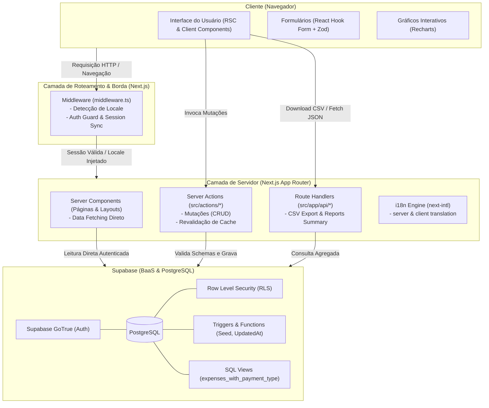
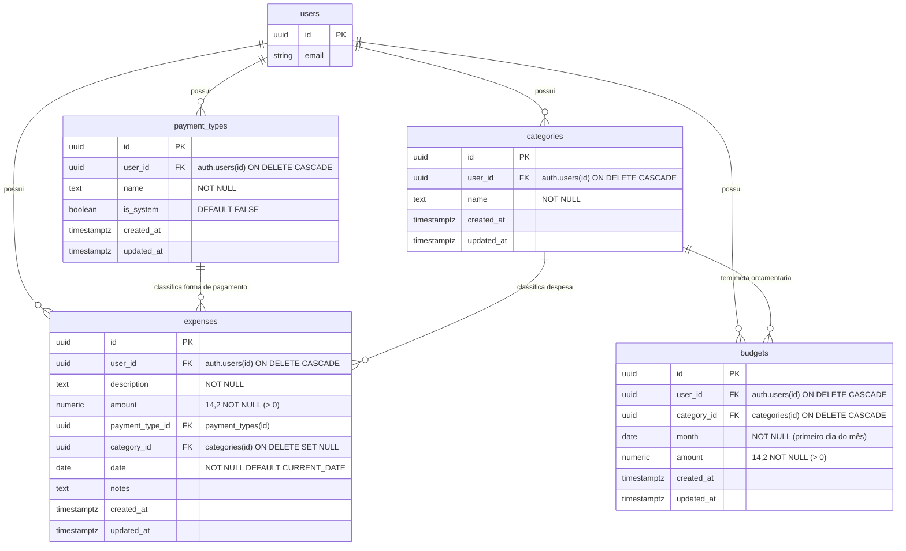

# Arquitetura e Visão Geral do Projeto — Expense Tracker

Este documento apresenta uma visão aprofundada da arquitetura técnica, modelo de dados, fluxos de aplicação, stack tecnológica e padrões de projeto adotados no **Expense Tracker** (`expending-app`).

---

## 1. Visão Geral do Projeto (Overview)

O **Expense Tracker** é uma aplicação web moderna para controle e gestão financeira pessoal. Foi construída com foco em desempenho, segurança, responsividade e experiência de uso fluida em dispositivos móveis e desktop.

### 1.1 Principais Capacidades e Funcionalidades

- **Autenticação e Gestão de Sessão**:
  - Cadastro de usuários, login e recuperação de senha via e-mail utilizando Supabase Auth.
  - Sincronização segura de tokens de sessão com suporte a Server-Side Rendering (SSR) via cookies HttpOnly.
  - Redirecionamento automático e proteção de rotas no middleware.
- **Gestão de Despesas (Expenses CRUD)**:
  - Criação, edição, visualização detalhada e exclusão de despesas.
  - Listagem com rolagem infinita (*infinite scroll*) paginada (25 itens por página).
  - Filtros avançados por intervalo de datas, categorias e formas de pagamento.
  - Campos completos: descrição, valor monetário, categoria, forma de pagamento, data e notas adicionais.
- **Formas de Pagamento Personalizáveis**:
  - Geração automática de 5 métodos de pagamento padrão ao criar conta (*Credit Card*, *Debit Card*, *PIX*, *Cash*, *Other* via trigger no banco).
  - Capacidade de renomear métodos padrão e criar métodos customizados.
  - Proteção de integridade referencial: impede exclusão de formas de pagamento com despesas vinculadas e protege métodos de sistema contra remoção acidental.
- **Categorias e Orçamentos Mensais**:
  - Criação e gerenciamento de categorias de despesas exclusivas por usuário.
  - Definição de limites orçamentários mensais por categoria com suporte a upsert (`onConflict: category_id, month`).
  - Comparativo em tempo real entre o orçado e o valor efetivamente gasto, com alertas percentuais e diferença financeira.
- **Relatórios Analíticos e Visualizações**:
  - Indicadores rápidos (KPIs) no Painel Principal: total gasto no mês corrente e quantidade de transações.
  - Gráficos interativos (via Recharts): evolução de gastos nos últimos 6 meses, distribuição por forma de pagamento (Pizza/Donut), evolução mensal e maiores despesas por descrição.
  - Tabela detalhada de despesas agrupadas por descrição com totais e percentuais.
  - Exportação de dados para CSV em conformidade com RFC-4180 com sanitização de caracteres e escape de aspas.
- **Internacionalização (i18n)**:
  - Suporte completo aos idiomas Português (`pt-BR`, moeda `BRL`) e Inglês (`en-US`, moeda `USD`).
  - Detecção automática de idioma via cookie (`NEXT_LOCALE`) e header `Accept-Language`.
  - Formatação regionalizada de datas, moedas e validações no servidor e no cliente.
- **Interface e Experiência (UI/UX)**:
  - Design responsivo para telas móveis e desktop com menu drawer retrátil.
  - Suporte a Dark Mode nativo via Tailwind CSS.
  - Notificações reativas em formato Toast via Sonner.

---

## 2. Stack Tecnológica

| Camada | Tecnologia | Versão | Papel no Projeto |
| :--- | :--- | :--- | :--- |
| **Framework Web** | [Next.js](https://nextjs.org/) | 16.4.0 (Canary/App Router) | Renderização híbrida (RSC), rotas dinâmicas, Server Actions e API Handlers com Turbopack |
| **Biblioteca de UI** | [React](https://react.dev/) | 19.3.0 | Camada de renderização reativa e componentes de interface |
| **Linguagem** | [TypeScript](https://www.typescriptlang.org/) | 5.x | Tipagem estática fim a fim (end-to-end type safety) |
| **Estilização** | [Tailwind CSS](https://tailwindcss.com/) | v4 | Estilização utilitária moderna de alta performance com Turbopack |
| **Utilitários de CSS**| `clsx`, `tailwind-merge` | 2.x / 3.x | Concatenação e mesclagem condicional livre de conflitos de classes Tailwind |
| **Banco de Dados** | [PostgreSQL](https://www.postgresql.org/) (Supabase) | 15+ | Banco relacional com integridade referencial, Triggers, RLS e Views |
| **BaaS / Autenticação**| [Supabase](https://supabase.com/) (`@supabase/ssr`) | 2.x / 0.12.x | Gerenciamento de usuários, tokens JWT e autenticação SSR via cookies |
| **Validação de Schemas**| [Zod](https://zod.dev/) | 3.25.x | Validação tipada de esquemas com mensagens internacionalizadas no cliente e servidor |
| **Formulários** | [React Hook Form](https://react-hook-form.com/) | 7.89.x | Gerenciamento de estado de formulários e integração via `@hookform/resolvers` |
| **Gráficos** | [Recharts](https://recharts.org/) | 3.10.x | Gráficos SVG reativos (Barras, Pizza e Donut) |
| **Internacionalização**| [next-intl](https://next-intl-docs.vercel.app/) | 4.14.x | Gestão de traduções e formatos de data/moeda em RSC e Client Components |
| **Datas** | `date-fns` e `Intl` nativo | 4.x | Manipulação e formatação de datas e fusos horários (`America/Sao_Paulo`) |
| **Feedback ao Usuário**| [Sonner](https://sonner.emilkowal.ski/) | 2.0.x | Sistema leve e customizado de toasts e alertas |

---

## 3. Arquitetura do Sistema e Fluxo de Dados

A arquitetura do sistema adota os princípios do **Next.js App Router** com **React Server Components (RSC)** e **Server Actions**, minimizando a quantidade de JavaScript transferido ao cliente e executando a lógica de negócio e queries de banco de dados diretamente no servidor com total segurança.



### 3.1 Ciclo de Requisição e Middleware

O arquivo [`middleware.ts`](file:///c:/projetos/expense-app/middleware.ts) atua como gateway de cada requisição:
1. **Detecção de Idioma**: Lê o cookie `NEXT_LOCALE`. Caso ausente, analisa o header HTTP `Accept-Language` para definir `pt` ou `en`, gravando o cookie persistente por 1 ano.
2. **Sincronização de Sessão (`updateSession`)**: Utiliza o `@supabase/ssr` para renovar tokens JWT e atualizar cookies de autenticação na resposta.
3. **Guarda de Rotas (Auth Guard)**:
   - Rotas protegidas (`/dashboard`, `/expenses`, `/payment-types`, `/reports`, `/budgets`, `/categories`): redireciona para `/login` se o usuário não estiver autenticado.
   - Rotas de autenticação (`/login`, `/register`, `/reset-password`): redireciona para `/dashboard` se o usuário já possuir sessão ativa.

### 3.2 Padrão de Componentes: Server vs Client

- **React Server Components (RSC)**:
  - Páginas principais (`page.tsx`) e layouts (`layout.tsx`).
  - Executam no servidor, acessam o banco Supabase diretamente sem expor credenciais nem payload desnecessário ao navegador.
  - Exemplo: busca direta de despesas, categorias e orçamentos para renderização inicial rápida e sem tela branca de carregamento.
- **Client Components (`'use client'`)**:
  - Utilizados exclusivamente onde há interatividade, como formulários dinâmicos (`expense-form.tsx`), captura de eventos, gráficos (`recharts`), botões de confirmação de exclusão com alerta e rolagem infinita (`expense-infinite-list.tsx`).

### 3.3 Mutações com Server Actions

As operações de escrita não dependem de APIs REST tradicionais; são executadas através de Server Actions localizadas em [`src/actions/`](file:///c:/projetos/expense-app/src/actions):
- **Validação no Servidor**: Os dados recebidos via `FormData` são submetidos aos esquemas Zod internacionalizados (`src/lib/validations/`).
- **Resposta Padronizada**: Retornam o contrato `ActionResult<T>`:
  ```typescript
  export interface ActionResult<T = void> {
    data?: T;
    error?: string;
    errors?: Record<string, string[]>;
  }
  ```
- **Invalidação de Cache**: Chamam `revalidatePath(...)` nos caminhos afetados para que o Next.js atualize instantaneamente a árvore de renderização do cliente.

---

## 4. Modelagem de Dados e Banco de Dados (Supabase)

O banco de dados relacional utiliza o PostgreSQL gerenciado pelo Supabase. O isolamento de dados entre usuários (*multi-tenancy*) é estritamente garantido no nível do banco via **Row Level Security (RLS)** através do identificador `auth.uid() = user_id`.

### 4.1 Diagrama Entidade-Relacionamento (ERD)



### 4.2 Detalhamento das Tabelas e Restrições

1. **`public.payment_types`**:
   - Armazena as formas de pagamento disponíveis para cada usuário.
   - Constraint de unicidade: `UNIQUE (user_id, name)` — impede nomes duplicados para o mesmo usuário.
   - Flag `is_system`: indica se é uma forma criada pelo sistema (protegida contra exclusão via política RLS).
2. **`public.categories`**:
   - Organiza as despesas em agrupamentos funcionais (ex: Alimentação, Moradia, Transporte).
   - Constraint de unicidade: `UNIQUE (user_id, name)` e validação de nome não vazio.
3. **`public.expenses`**:
   - Tabela central do aplicativo.
   - `amount`: valor numérico com precisão `(14, 2)` e checagem positiva `CHECK (amount > 0)`.
   - `date`: data da ocorrência da despesa (tipo `DATE`).
   - Índices de performance:
     - `idx_expenses_user_id` e `idx_expenses_user_date (user_id, date DESC)` para buscas e paginação ultrarrápidas.
     - `idx_expenses_payment_type_id` e `idx_expenses_category_id` para junções e filtros.
4. **`public.budgets`**:
   - Registra o limite orçamentário mensal definido por categoria.
   - Constraint `budgets_month_first_day`: garante que o campo `month` seja sempre o primeiro dia do mês (`date_trunc('month', month)::date`).
   - Constraint `UNIQUE (category_id, month)`: garante um único orçamento por categoria em um mês específico, viabilizando operações de *upsert*.

### 4.3 Visões do Banco (Views)

- **`public.expenses_with_payment_type`**:
  - Realiza o `JOIN` entre `expenses`, `payment_types` e `categories`, retornando campos denormalizados para relatórios e listagens (`payment_type_name`, `category_name`).
  - Configurada com `ALTER VIEW ... SET (security_invoker = TRUE)` para que as políticas de RLS das tabelas base sejam rigorosamente respeitadas quando a view for consultada por qualquer usuário.

### 4.4 Automações e Triggers no PostgreSQL

1. **Atualização de Timestamps (`handle_updated_at`)**:
   - Atualiza automaticamente a coluna `updated_at` antes de qualquer mutação (`BEFORE UPDATE`) nas tabelas `payment_types`, `expenses`, `categories` e `budgets`.
2. **Seed Automático de Formas de Pagamento (`seed_default_payment_types`)**:
   - Disparado automaticamente após a criação de um novo usuário (`AFTER INSERT ON auth.users`).
   - Insere de forma imediata os 5 métodos padrão com `is_system = true`, permitindo que o usuário recém-registrado comece a lançar despesas imediatamente.
3. **Keepalive com `pg_cron`**:
   - Job agendado (`0 12 */4 * *`) executando `SELECT 1` para manter o banco Supabase aquecido, prevenindo a suspensão automática por inatividade no plano gratuito.

---

## 5. Estrutura de Diretórios do Projeto

```
expense-app/
├── .claude/                   # Configurações do ambiente Claude
├── .vscode/                   # Configurações do editor VSCode
├── messages/                  # Dicionários de internacionalização (JSON)
│   ├── en.json                # Mensagens e labels em Inglês
│   └── pt.json                # Mensagens e labels em Português
├── public/                    # Arquivos estáticos e ícones SVG
├── src/
│   ├── actions/               # Server Actions (Mutações e Regras de Negócio)
│   │   ├── auth.ts            # Login, Registro, Logout, Redefinição de senha
│   │   ├── budgets.ts         # Upsert e exclusão de orçamentos
│   │   ├── categories.ts      # CRUD de categorias
│   │   ├── expenses.ts        # CRUD e listagem paginada de despesas
│   │   └── payment-types.ts   # CRUD de formas de pagamento
│   ├── app/                   # App Router do Next.js
│   │   ├── (auth)/            # Grupo de rotas públicas de autenticação
│   │   │   ├── layout.tsx     # Layout centralizado dos formulários de auth
│   │   │   ├── login/         # Página de login
│   │   │   ├── register/      # Página de cadastro
│   │   │   └── reset-password/# Página de recuperação/redefinição de senha
│   │   ├── (dashboard)/       # Grupo de rotas autenticadas com layout padrão
│   │   │   ├── layout.tsx     # Layout contendo Sidebar e MobileHeader
│   │   │   ├── loading.tsx    # Skeleton de carregamento padrão
│   │   │   ├── error.tsx      # Fallback de erro da área autenticada
│   │   │   ├── dashboard/     # Painel principal com métricas e gráficos rápidos
│   │   │   ├── expenses/      # Listagem, filtros e subrotas [id] e /new
│   │   │   ├── categories/    # Gerenciador de categorias de despesa
│   │   │   ├── budgets/       # Gerenciador de orçamentos mensais
│   │   │   ├── payment-types/ # Gerenciador de formas de pagamento
│   │   │   └── reports/       # Relatórios analíticos com gráficos e exportação
│   │   ├── api/               # API Route Handlers
│   │   │   └── reports/
│   │   │       ├── export/    # Endpoint GET para geração e download de CSV
│   │   │       └── summary/   # Endpoint GET para agregação estatística
│   │   ├── globals.css        # Importações globais e diretivas do Tailwind CSS v4
│   │   ├── layout.tsx         # Root Layout (Fontes Geist, I18nProvider)
│   │   └── page.tsx           # Redirecionamento da raiz ('/')
│   ├── components/            # Componentes React organizados por domínio
│   │   ├── auth/              # Componentes de formulários de autenticação
│   │   ├── budgets/           # Componente de gestão de orçamento mensal
│   │   ├── categories/        # Lista e formulários modais de categorias
│   │   ├── expenses/          # Formulários, lista infinita e filtros de despesas
│   │   ├── layout/            # Sidebar de navegação, MobileHeader, LogoutButton
│   │   ├── payment-types/     # Listagem e edição de formas de pagamento
│   │   ├── reports/           # Gráficos Recharts, tabelas agregadas e botão CSV
│   │   ├── ui/                # Componentes base reutilizáveis (Spinner, LoadingState)
│   │   └── i18n-provider.tsx  # Provedor de contexto do next-intl para o cliente
│   ├── i18n/                  # Configurações de i18n do Next.js
│   │   └── request.ts         # Configuração de contexto do next-intl por requisição
│   ├── lib/                   # Utilitários compartilhados, clientes e schemas
│   │   ├── supabase/          # Clientes Supabase com suporte a SSR
│   │   │   ├── client.ts      # Cliente para uso em Client Components
│   │   │   ├── middleware.ts  # Tratamento de sessão e cookies no middleware
│   │   │   └── server.ts      # Cliente instanciado com cookies em Server Components/Actions
│   │   ├── validations/       # Schemas de validação Zod tipados e traduzidos
│   │   │   ├── budget.ts
│   │   │   ├── category.ts
│   │   │   ├── expense.ts
│   │   │   └── payment-type.ts
│   │   ├── i18n.server.ts     # Helpers de tradução no contexto do servidor
│   │   ├── i18n.types.ts      # Definições de tipos para internacionalização
│   │   └── utils.ts           # Utilitários de moeda, data, Tailwind e timezone
│   └── types/                 # Interfaces TypeScript e definições do Supabase
│       ├── index.ts           # Tipos de filtros, relatórios e contratos de ação
│       └── supabase.ts        # Tipagem gerada a partir do schema do PostgreSQL
├── supabase/                  # Scripts e migrações do banco de dados
│   └── migrations/
│       ├── 001_initial_schema.sql      # Schema inicial: expenses, payment_types, triggers
│       └── 002_categories_budgets.sql   # Schema de categories, budgets e atualização da view
├── middleware.ts              # Interceptador global de requisições Next.js
├── next.config.ts             # Configuração do Next.js (com plugin next-intl)
├── package.json               # Dependências e scripts do projeto
├── README.md                  # Guia de início rápido e instalação
└── tsconfig.json              # Configurações do compilador TypeScript
```

---

## 6. Fluxos de Negócio e Detalhes de Implementação

### 6.1 Fluxo de Cadastro e Onboarding do Usuário

1. O usuário preenche o formulário de cadastro em `/register`.
2. A ação `register` ([`src/actions/auth.ts`](file:///c:/projetos/expense-app/src/actions/auth.ts)) invoca `supabase.auth.signUp()`.
3. O Supabase grava o usuário na tabela interna `auth.users`.
4. O trigger PostgreSQL `trg_seed_payment_types` dispara imediatamente e popula a tabela `public.payment_types` com as opções padrão para aquele novo `user_id`.
5. O usuário confirma a conta e faz login em `/login`, recebendo os cookies de sessão seguros.

### 6.2 Consulta de Despesas com Rolagem Infinita e Filtros

1. Ao acessar `/expenses`, o componente de servidor busca a primeira página (25 itens) usando `getExpenses()` ([`src/actions/expenses.ts`](file:///c:/projetos/expense-app/src/actions/expenses.ts)).
2. Os filtros de data (`date_from`, `date_to`), forma de pagamento (`payment_type_id`) e categoria persistem na URL como *search parameters*.
3. O componente cliente `ExpenseInfiniteList` gerencia o estado da lista. Ao atingir o final da página ou clicar em "Carregar mais", invoca a Server Action para buscar as páginas subsequentes via `.range(from, to)`.

### 6.3 Orçamentos e Relatório Comparativo

1. Na rota `/budgets`, o usuário define uma meta monetária mensal para cada categoria.
2. A ação `saveBudget` ([`src/actions/budgets.ts`](file:///c:/projetos/expense-app/src/actions/budgets.ts)) normaliza a data para o primeiro dia do mês e executa o `upsert` com resolução de conflito em `(category_id, month)`.
3. Na página `/reports`, o Server Component combina em tempo real:
   - Categorias cadastradas.
   - Total de despesas daquele mês por categoria.
   - Limite orçado para o mês corrente.
4. O componente `CategoryBudgetReport` calcula os percentuais e renderiza barras de progresso informativas, sinalizando se os gastos estão dentro ou acima do limite orçado.

### 6.4 Agregação e Exportação CSV

- **Exportação CSV** ([`/api/reports/export`](file:///c:/projetos/expense-app/src/app/api/reports/export/route.ts)):
  - Endpoint HTTP GET protegido por autenticação.
  - Recebe os parâmetros de filtro de datas e método de pagamento.
  - Monta os cabeçalhos (`Date,Description,Amount,Payment Type,Notes`) e escapa devidamente campos com aspas duplas e quebras de linha.
  - Responde com stream de texto com header `Content-Type: text/csv; charset=utf-8` e `Content-Disposition: attachment`.

---

## 7. Práticas de Segurança e Desempenho Adotadas

- **Isolamento de Dados Multi-tenant**: Todas as tabelas têm Row Level Security (RLS) habilitada, garantindo que queries maliciosas ou falhas na camada de aplicação nunca exponham dados de outros usuários.
- **Defesa em Profundidade contra SQL Injection**: Uso do query builder parametrizado da biblioteca `@supabase/supabase-js`.
- **Integridade Referencial**: Uso de chaves estrangeiras (`ON DELETE CASCADE` para vínculo do usuário e `ON DELETE SET NULL` para categorias em despesas), impedindo registros órfãos.
- **Validação de Entrada Dupla**: Validação síncrona com Zod nos formulários do cliente e revalidação estrita no servidor nas Server Actions antes de persistir dados.
- **Sanitização de CSV**: Tratamento de caracteres especiais para evitar ataques de injeção de fórmulas em planilhas (CSV/Formula Injection).
- **Sem Fuga de Segredos**: As variáveis do banco utilizam a chave anônima pública (`NEXT_PUBLIC_SUPABASE_ANON_KEY`) amparada exclusivamente pelo RLS do Postgres; chaves com privilégios de serviço (*service_role*) não são necessárias na aplicação cliente/servidor.

---

## 8. Guia de Ambiente e Configuração

### 8.1 Variáveis de Ambiente

Crie um arquivo `.env.local` na raiz do projeto com base nas seguintes chaves:

```env
# URL base do projeto Supabase
NEXT_PUBLIC_SUPABASE_URL=https://sua-url-supabase.supabase.co

# Chave anônima pública do Supabase
NEXT_PUBLIC_SUPABASE_ANON_KEY=sua-chave-anon-jwt

# URL base da aplicação (utilizada para redirecionamentos de e-mail e autenticação)
NEXT_PUBLIC_SITE_URL=http://localhost:3000
```

### 8.2 Scripts Disponíveis

```bash
# Instalação das dependências
npm install

# Início do servidor de desenvolvimento com Turbopack
npm run dev

# Criação do build de produção
npm run build

# Execução do servidor em modo de produção
npm run start

# Execução da análise estática com ESLint
npm run lint
```

